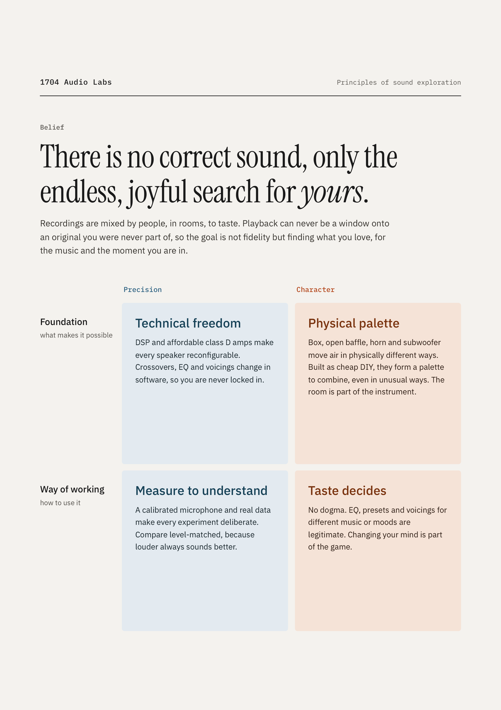

# 1704 Audio Labs — Measure & Taste

**There is no correct sound, only the endless, joyful search for *yours*.**

The belief and the four principles behind 1704 Audio Labs' DIY loudspeakers, and the projects built
on them. Live at **https://1704audiolabs.github.io/**.

## Projects

| | Project | |
| --- | --- | --- |
| 01 | **[Le Petit](https://github.com/1704audiolabs/le-petit)** — Jean Hiraga's Le Petit from one sheet of OSB with an Aiyima 4″ driver, tuned by measurement | [website](https://1704audiolabs.github.io/le-petit/) |
| 02 | **[Le Petit Sub](https://github.com/1704audiolabs/le-petit-sub)** — Le Petit's bigger twin: a sealed subwoofer with two opposed 10″ drivers | [website](https://1704audiolabs.github.io/le-petit-sub/) |

## This repository

`index.html` is the whole site (plain HTML, no build), `assets/site.css` its styles, `assets/img/` the
images. GitHub Pages serves it from `main`. Texts and images CC BY-SA 4.0 ([LICENSE](LICENSE)).
